# Звіт з лабораторної роботи № 2

**Контракт API, серверна валідація та захист від SQL injection**

| Параметр | Значення |
|---|---|
| Дисципліна | Прикладні технології програмування в інформаційній безпеці |
| Варіант | baseline 2-A «Трекер інцидентів» (індивідуальних варіантів у ЛР 2 немає, єдиний для потоку) |
| Робоча гілка | lab/2-input-sqli (створена від тегу v0.1.0) |
| Вхідний стан | власний тег v0.1.0 → 2c8e930 + scaffold lab-02-start-v1 |
| Release ID scaffold / base commit | lab-02-start-v1; base_commit 2c8e930…, entry_parent cbac4ea… (.scaffolds/lab-02.json) |
| Vulnerable commit | da672b84e8affe12867f0c6dfc07e14b2a7a6b9d |
| Fixed commit | 20f7d62a5fe368b5ccc4507c826d3d671c7015de |
| Фінальний тег | v0.2.0 (annotated) → 20f7d62 |
| Середовище | Windows 10, .NET SDK 10.0.400, PostgreSQL 17.6 на 127.0.0.1:54329 (БД/роль securelab), Development |
| Репозиторій | github.com/1307egor-commits/securelab-lab1 |

## Коротко про роботу

У ЛР 1 я лише простежив готовий маршрут. У ЛР 2 у власний проєкт встановлено навчальний scaffold, який додає POST /api/incidents і GET /api/incidents/search. Пошук навмисно уразливий: значення з URL склеюється з текстом SQL. Завдання - дати створенню інциденту явний контракт із серверною перевіркою, відтворити SQL injection лише на локальному стенді одним дозволеним read-only сценарієм, усунути першопричину й довести це тестами.

Головна зміна - механізм, а не блокування окремого рядка: сервер приймає лише дозволені поля, перевіряє їх сам, повертає передбачувані безпечні помилки, а значення пошуку більше ніколи не стає частиною структури SQL-команди.

**Ключові поняття:**

- request DTO - тип, що описує лише поля, які клієнт має право надіслати (CreateIncidentRequest). Він не є entity.
- overposting (mass assignment) - коли клієнт надсилає «зайве» поле (ownerUserId, status) і воно потрапляє в модель збереження.
- Problem Details - стандартне тіло помилки (application/problem+json) з полями type/title/status/errors без внутрішніх деталей.
- параметризація - SQL-шаблон незмінний, а значення передається окремо (@pattern), тому СУБД не інтерпретує його як SQL.
- allowlist - явний перелік дозволених логічних значень (sortBy), кожне з яких сервер сам перетворює на вираз.

## Етап 1. Контрольований навчальний стан

### 1. Гілка від v0.1.0 і baseline-перевірка

```text
git switch -c lab/2-input-sqli v0.1.0      -> Switched to a new branch 'lab/2-input-sqli'
git log --oneline -1                      -> 2c8e930 Merge lab/1-system: stage 3 incident severity summary flow
dotnet test tests/SecureLab.Api.Tests/SecureLab.Api.Tests.csproj --configuration Release
                                          -> Пройден! не пройдено 0, пройдено 8, всего 8
```

Робоче дерево було чистим, ЛР 1 збережена тегом v0.1.0. PostgreSQL працює з тим самим контрактом, що й infra/compose.yaml (127.0.0.1:54329, БД і роль securelab); на цьому ПК Docker Desktop не запускається, тому сервер PostgreSQL 17.6 запущено локально з portable-збірки - адреса, порт і облікові дані ті самі.

### 2. Встановлення scaffold lab-02-start-v1

Перший dry run installer-а зупинився до будь-якого запису:

```text
python install.py 02 D:/reposit/securelab-lab1
[Errno 2] No such file or directory: 'D:\reposit\securelab-lab1\src\SecureLab.Api\Data\DatabaseBootstrap.cs'
```

Причина: мій starter для ЛР 1 відтворено з методички, і він відрізнявся від канонічного в тих місцях, на які розраховує scaffold. Файли scaffold я не змінював (їх SHA-256 перевіряє installer), а окремим комітом cbac4ea «Align starter plumbing with lab-02 scaffold contract» узгодив лише plumbing:

- entity перенесено в простір імен SecureLab.Api.Data.Entities (Data/Entities/) - scaffold має using SecureLab.Api.Data.Entities;
- в Incident додано server-managed поле UpdatedAtUtc - scaffold і контракт 2-A його встановлюють;
- колонки PostgreSQL отримали snake_case-імена (title, created_at_utc, …) міграцією AlignScaffoldSchema - сирий SQL scaffold звертається саме до них;
- Data/DatabaseBootstrap.cs - єдина точка migrations/reset/seed для Program.cs і тестової фабрики (якір installer-а);
- app.UseExceptionHandler() поряд з AddProblemDetails() - безпечні 500 без stack trace (за методичкою обидва виклики мають бути в starter).

Після цього baseline-тести лишились зеленими, і installer відпрацював (dry run, потім --write):

```text
python install.py 02 D:/reposit/securelab-lab1 --write
src/SecureLab.Api/Scaffolding/Lab02Endpoints.cs
src/SecureLab.Api/Scaffolding/Lab02Seed.cs
tests/SecureLab.Api.Tests/AssemblyInfo.cs
tests/SecureLab.Api.Tests/SearchMechanicsTests.cs
tests/http/lab-02-search.http
src/SecureLab.Api/Program.cs
src/SecureLab.Api/Data/DatabaseBootstrap.cs
.scaffolds/lab-02.json
Scaffold installed. Review diff, restore/build, verify; completion is student work.
```

- Квитанція .scaffolds/lab-02.json: release lab-02-start-v1, inherits v0.1.0, base_commit 2c8e930…, entry_parent cbac4ea….
- Для SearchMechanicsTests у тестовий проєкт додано глобальний using Xunit.
- Lab02Seed додає два Low-інциденти (O'Brien… і «Перевірка USB…»), тому очікування підсумку ЛР 1 оновлено до Low=3, Medium=1, High=1 (asserts не послаблено).
- Коміт 9bb1a43 «Install lab-02-start-v1 scaffold…»; dotnet test - 9 з 9.

Як цей стан відтворити: dotnet run --project src/SecureLab.Api -- --reset-database, потім dotnet run --project src/SecureLab.Api (API на http://localhost:5080).

### 3. Перша перевірка наданого пошуку

Звичайний пошук q=USB працює; легітимний апостроф (O'Brien, комп'ютерного) дає 500 - це перше спостереження, яке пояснюю на етапі 3 (знімки sc2-01 і sc2-03).

## Етап 2. Контракт створення інциденту

### 1. Зовнішній контракт POST /api/incidents (baseline 2-A)

| Поле | Хто визначає | Правило / рішення сервера |
|---|---|---|
| title | клієнт | обов'язкове, після Trim() непорожнє, ≤ 160 символів |
| description | клієнт | обов'язкове, після Trim() непорожнє, ≤ 4000; для High/Critical ≥ 40 (cross-field); не повторює title (T-10) |
| severity | клієнт | Enum.TryParse(ignoreCase) + Enum.IsDefined + точна назва: Low, Medium, High, Critical |
| occurredAtUtc | клієнт | обов'язкове; не пізніше за UTC-час сервера + 5 хв (час фіксується один раз на початку обробки) |
| id | сервер | Guid.NewGuid(); у DTO немає |
| ownerUserId | сервер | фіксований навчальний контекст Alice (ЛР 3 замінить на verified principal); у DTO немає |
| status | сервер | завжди New; у DTO немає |
| createdAtUtc / updatedAtUtc | сервер | той самий зафіксований час обробки; у DTO немає |
| відповідь 201 | сервер | CreatedIncidentResponse: id, title, severity, status, occurredAtUtc, createdAtUtc, updatedAtUtc + Location |

| Ситуація | Приклад | Відповідь |
|---|---|---|
| некоректний контракт | порожній title, severity "7", без occurredAtUtc, дата +10 хв, битий JSON | 400 Validation Problem Details |
| помилка взаємозалежних полів | High + description 39 символів після Trim() | 400, ключ description |
| предметний конфлікт | другий не закритий інцидент з тим самим title | 409 Problem Details |
| ресурс не знайдено | GET /api/incidents/99999999-… | 404 Problem Details |
| неочікувана помилка | збій поза контрактом | 500 Problem Details без внутрішніх деталей |

### 2. Реалізація

- Presentation/Contracts/IncidentRequests.cs - record CreateIncidentRequest(string? Title, string? Description, string? Severity, DateTimeOffset? OccurredAtUtc). Nullable чесно показує, що клієнт може поле не надіслати; обов'язковість забезпечує перевірка.
- Application/Incidents/CreateIncidentValidator.cs - збирає помилки в Dictionary<string, string[]>; Title/Description нормалізуються Trim() один раз, і саме ці значення йдуть у cross-field правило, перевірку конфлікту та entity. Якщо є помилки - Results.ValidationProblem(errors) до доступу до БД.
- Application/Incidents/IncidentCommands.cs - AnyAsync(title == … && status != Closed) → 409; далі entity з серверними Id, owner, status, audit-часами; SaveChanges.
- Частковий унікальний індекс ux_incidents_active_title (title WHERE status <> 'Closed') - остання лінія цілісності для паралельних запитів; очікуване порушення саме цього обмеження теж перетворюється на 409, а не на 500. Інші винятки БД «валідацією» не вважаються.
- Program.cs - UseExceptionHandler зі StatusCodeSelector: BadHttpRequestException (битий JSON) → 400 Problem Details, решта → 500 без деталей.

```text
if (string.IsNullOrWhiteSpace(request.Severity)) { errors["severity"] = [...]; }
else if (!Enum.TryParse<IncidentSeverity>(request.Severity, ignoreCase: true, out var parsed)
         || !Enum.IsDefined(parsed)
         // TryParse приймає також "2" і "Low, High" (0|2 = High) - вони проходять IsDefined
         || !EnumNames.IsExactName<IncidentSeverity>(request.Severity))
{
    errors["severity"] = ["Допустимі значення: Low, Medium, High, Critical."];
}
```

Чому потрібні обидві перевірки: Enum.TryParse("7") успішно повертає (IncidentSeverity)7, бо enum у C# - це число; такого елемента немає, і саме Enum.IsDefined відхиляє його. Без IsDefined у БД потрапило б значення поза множиною. Додатково я з'ясував, що TryParse+IsDefined пропускають числовий псевдонім "2" і список "Low, High" - тому є третя перевірка точної назви (див. A-02).

### 3. Контрольна точка CP-01 - перевірений контракт створення

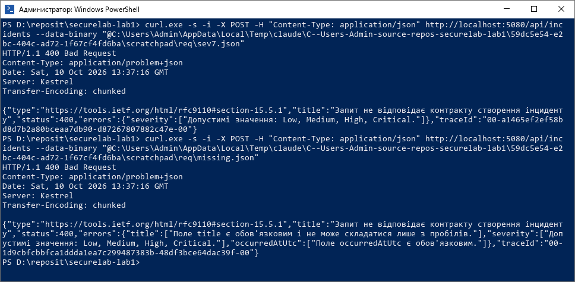

*POST із severity "7" → 400, application/problem+json, помилка лише за ключем severity. Другий запит: порожній title, невідомий severity і відсутній occurredAtUtc - три ключі одночасно.*

Маршрут: JSON → десеріалізація в CreateIncidentRequest (лише 4 поля) → CreateIncidentValidator → Results.ValidationProblem → 400 Problem Details. Елемент <select> у браузері обмежує лише те, що показує наш клієнт; curl, Postman або змінений DOM надсилають будь-який рядок, тому контроль має бути на сервері.

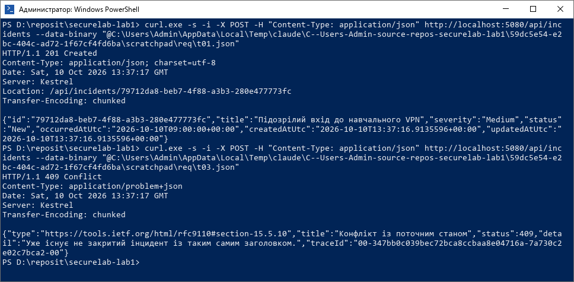

*T-01: коректний запит → 201 Created, Location і CreatedIncidentResponse (без ownerUserId і description). T-03: той самий title з пробілами навколо при статусі New → 409.*

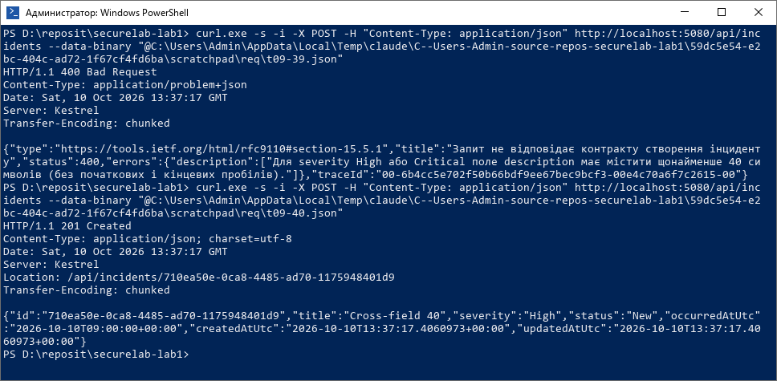

*T-09: High і description 39 символів після Trim() → 400 з ключем description; 40 символів → 201.*

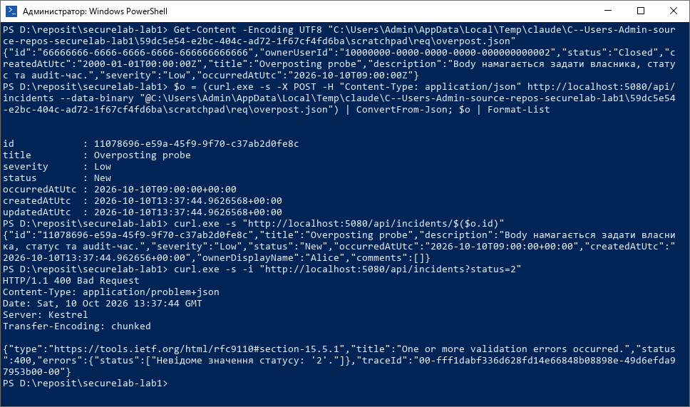

*Body містить id, ownerUserId (Bob), status Closed, createdAtUtc 2000 р. - сервер їх ігнорує: новий id, status New, власник Alice (видно в details). Нижче - A-02: ?status=2 у фільтрі списку тепер 400.*

Request не здатен передати OwnerUserId або status у модель створення: у CreateIncidentRequest таких властивостей немає, System.Text.Json пропускає невідомі поля, а entity заповнюється лише в IncidentCommands із серверних значень. Це підтверджує тест A02_ServerManagedFieldsInBody_AreIgnored, який читає запис із БД.

Ручні сценарії - tests/http/lab-02-incidents.http (T-01, T-02 ×6, T-03, T-09 ×2, T-10, A-02, T-06, пошук). Автотести - tests/SecureLab.Api.Tests/IncidentCreateTests.cs (22 тест-кейси).

## Етап 3. Vulnerable state і першопричина SQLi

### 1. Окремий vulnerable commit

Коміт da672b8 «Validate incident contract and reproduce controlled SQL injection» містить надані endpoint-и й seed, мої сценарії та виправлену валідацію створення, але ще не виправлений пошук. Тег на нього не ставиться. Supplied release - lab-02-start-v1 (коміт 9bb1a43); мій security diff - усе після нього.

**git rev-parse HEAD → da672b84e8affe12867f0c6dfc07e14b2a7a6b9d**

### 2. Маршрут q від URL до PostgreSQL і root cause

```text
GET /api/incidents/search?q=...&sortBy=...
  -> minimal API binding: параметри string? q, string? sortBy лямбди MapGet (Lab02Endpoints.cs:13)
  -> sortBy switch: "_ => sortBy" повертає сирий рядок клієнта як ORDER BY (рядок 18)
  -> var sql = "SELECT * ... title ILIKE '%" + q + "%' OR description ILIKE '%" + q + "%' ORDER BY " + order (рядки 20-21)
  -> db.Incidents.FromSqlRaw(sql) - один готовий текст іде в Npgsql/PostgreSQL (рядок 22)
  -> PostgreSQL сам розбирає, де дані, а де інструкція
```

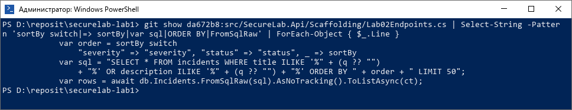

*Root cause у da672b8: src/SecureLab.Api/Scaffolding/Lab02Endpoints.cs, метод MapLab02Endpoints, обробник GET /api/incidents/search - конкатенація q і sortBy у SQL та виконання через FromSqlRaw.*

Що змінюється між вводами: для USB у текст потрапляє ILIKE '%USB%' - звичайні дані. Легітимний апостроф (O'Brien) закриває рядковий літерал раніше, і SQL стає синтаксично некоректним → виняток → 500. Контрольний ввід закриває літерал, додає власну умову, яка завжди істинна, і коментує решту шаблону - тобто змінює структуру WHERE.

### 3. Спостереження (локальний Development, після reset, vulnerable commit)

![API запущено з worktree на коміті da672b8. q=USB → 200, 1 запис (20000000-…-005). q=zz-no-match → 200, [].](screenshots/lab-02/sc2-01-before-normal-search.png)

*API запущено з worktree на коміті da672b8. q=USB → 200, 1 запис (20000000-…-005). q=zz-no-match → 200, [].*

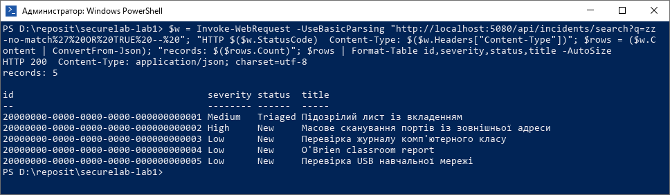

*Той самий текст zz-no-match + контрольна послідовність → 200 і всі 5 штучних записів: вибірку розширено.*

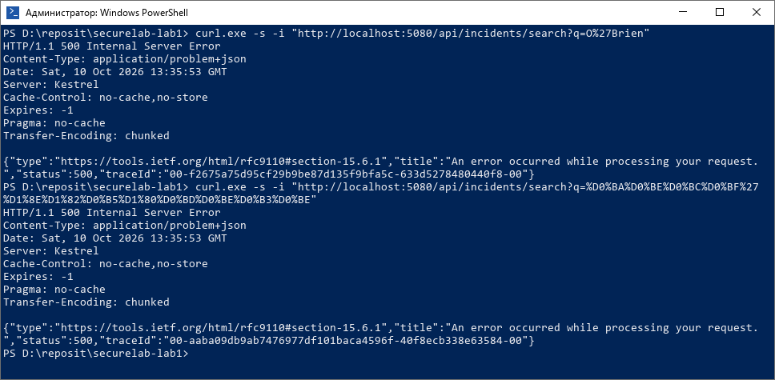

*Легітимні значення з апострофом U+0027 (O'Brien, комп'ютерного) → 500 Problem Details (без stack trace, але пошук зламаний).*

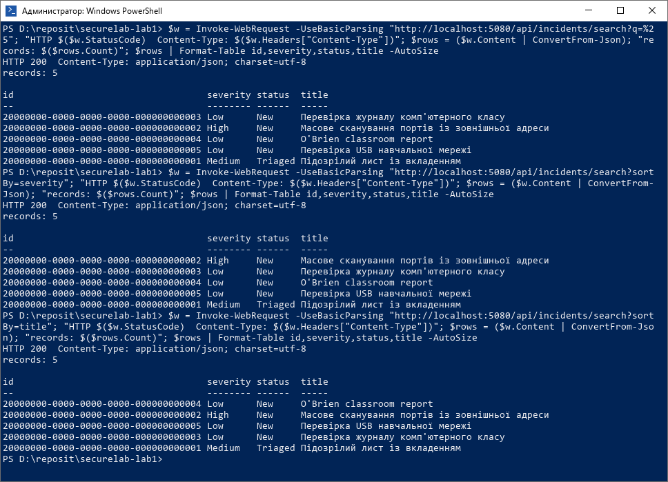

*q=% повертає все (метасимвол ILIKE не екранується); sortBy=severity сортує лексикографічно (High, Low, Medium); sortBy=title (поза задуманим набором) напряму керує ORDER BY.*

| Поле | Що записано |
|---|---|
| Передумови | local Development, PostgreSQL 127.0.0.1:54329, --reset-database, vulnerable commit da672b8 |
| Дія | GET /api/incidents/search з контрольним вводом (URL-encoded); тест SearchSecurityTests.S02_ControlInput_DoesNotWidenResults |
| Очікування без defect | результат такий самий, як для q=zz-no-match: 200 і 0 записів |
| Фактичне спостереження | 200, 5 записів: 20000000-0000-0000-0000-000000000001 … 000000000005 (усі штучні інциденти) |
| Пояснення | апостроф закрив рядковий літерал, OR TRUE став частиною WHERE, -- закоментував хвіст шаблону; PostgreSQL виконав іншу логіку запиту |

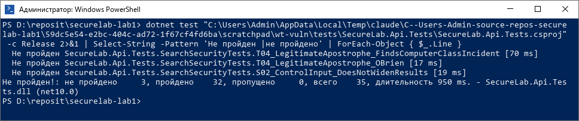

*dotnet test на vulnerable commit: валідаційні тести й штатний пошук зелені, червоні рівно три - два T-04 з апострофом і S-02 з контрольним вводом.*

Нотатка до редагування: «Замість передавати в PostgreSQL SQL-текст, до якого вже приєднано q, я будую запит LINQ із EF.Functions.ILike, де шаблон іде окремим параметром із екранованими %, _ і \. Значення sortBy я зіставляю з allowlist (createdAtUtc, severity, status) і для кожного маю власний LINQ-вираз; усе інше - 400.»

### 4. Контрольна точка CP-02 - доказ першопричини

- Vulnerable commit da672b8; точка складання SQL - Lab02Endpoints.cs:20-21, виконання - :22, структурний sortBy - :18.
- Нормальний пошук (USB) і власний read-only тест S-02 зафіксовано в таблиці вище.
- Чому фільтр апострофа або «OR …» не є виправленням: він ламає легітимні дані (O'Brien, комп'ютерного), не покриває інші контексти (sortBy узагалі не в лапках - там апостроф не потрібен) і лише реагує на конкретний payload, тоді як механізм - змішування даних і структури - лишається.
- Запланований механізм: LINQ + EF.Functions.ILike (параметр) для значення, allowlist для структури.
- Докази: docs/evidence/lab-02/search-before.txt, dotnet-test-vulnerable.txt, a02-before.txt.

## Етап 4. Усунення першопричини й регресія

### 1. Що змінено

```text
// Application/Incidents/IncidentQueries.cs - SearchAsync
var pattern = "%" + EscapeLikePattern(q) + "%";          // \ -> \\, % -> \%, _ -> \_
query = query.Where(i => EF.Functions.ILike(i.Title, pattern, "\\")
                      || EF.Functions.ILike(i.Description, pattern, "\\"));
var ordered = sort switch
{
    IncidentSearchSort.Severity => query.OrderBy(i => i.Severity == Critical ? 0 : i.Severity == High ? 1
                                                   : i.Severity == Medium ? 2 : 3).ThenByDescending(i => i.CreatedAtUtc),
    IncidentSearchSort.Status   => query.OrderBy(i => /* New 0 … Closed 4 */).ThenByDescending(i => i.CreatedAtUtc),
    _                           => query.OrderByDescending(i => i.CreatedAtUtc)
};
return await ordered.ThenBy(i => i.Id).Take(50).Select(i => new IncidentSearchItemResponse(...)).ToListAsync(ct);

// Scaffolding/Lab02Endpoints.cs - allowlist
SortAllowlist = { ["createdAtUtc"] = CreatedAtUtc, ["severity"] = Severity, ["status"] = Status };
if (!string.IsNullOrEmpty(sortBy) && !SortAllowlist.TryGetValue(sortBy, out sort))
    errors["sortBy"] = ["Допустимі значення sortBy: createdAtUtc, severity, status."];
```

- FromSqlRaw і рядок SQL прибрано повністю; q передається як значення параметра, а структуру SQL генерує EF Core з LINQ.
- ILIKE має власну мову шаблонів, тому %, _ і сам escape-символ \ екрануються - пошук є literal substring.
- sortBy: відсутнє або порожнє → createdAtUtc DESC; невідоме → 400 з ключем sortBy ще до звернення до БД. Порядок severity - Critical, High, Medium, Low; status - New, Triaged, InProgress, Resolved, Closed (явне ранжування, бо в БД це текст).
- Окремий IncidentSearchItemResponse замість анонімної проєкції entity; q довше 200 символів → 400 (ключ q).

**Фрагмент журналу EF Core на fixed state (значення параметрів не журналюються):**

```text
Executed DbCommand [Parameters=[@pattern='?', @pattern0='?', @p='?' (DbType = Int32)]
WHERE i.title ILIKE @pattern ESCAPE '\' OR i.description ILIKE @pattern0 ESCAPE '\'
ORDER BY i.created_at_utc DESC, i.id
```

### 2. Retest і позитивна регресія (fixed commit, той самий seed)

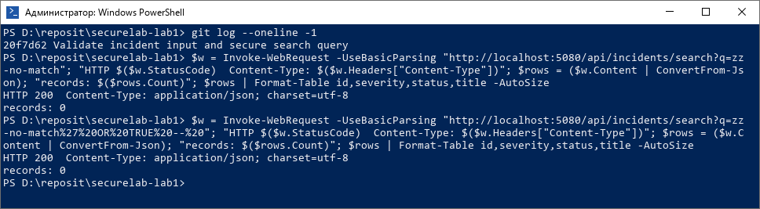

*S-02: той самий контрольний ввід → 200 і 0 записів - рівно як для q=zz-no-match. Множина результатів не розширюється.*

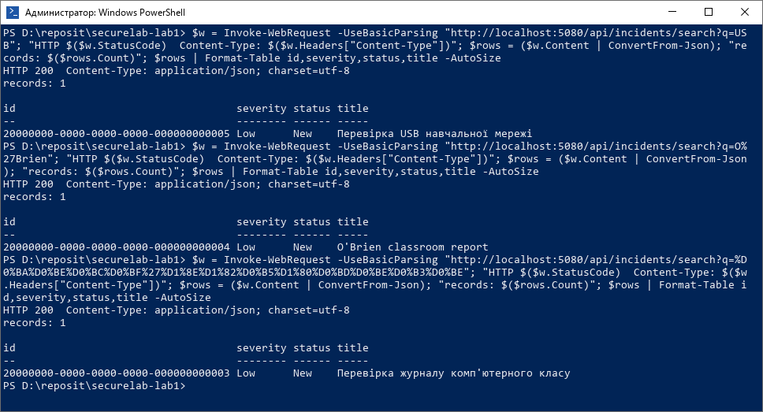

*T-04: USB → 1 запис; O'Brien → 20000000-…-004; комп'ютерного → 20000000-…-003. Без 500, поведінка звичайного пошуку.*

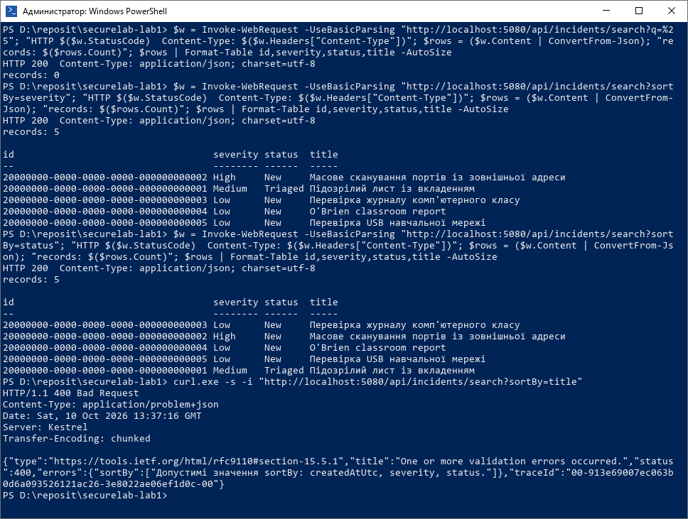

*q=% → 0 записів (знак відсотка шукається буквально); sortBy=severity - Critical/High/Medium/Low; sortBy=status - за workflow; sortBy=title → 400 з ключем sortBy (T-05).*

**Автотести (tests/SecureLab.Api.Tests/SearchSecurityTests.cs) перевіряють властивість результату, а не лише відсутність 500:**

- S02_ControlInput_DoesNotWidenResults - 200, порожня множина, ідентична еталону q=zz-no-match (жодного зайвого чи чужого запису).
- T04_NormalSearch_Usb_ReturnsOnlyMatchingRecord - множина рівно {20000000-…-005}.
- T04_LegitimateApostrophe_FindsComputerClassIncident / _OBrien - потрібний запис знайдено, кожен результат містить шукане слово.
- Search_LikeMetacharacters_AreMatchedLiterally - власний запис із %, _ і \ знаходиться, а записи без цих символів не повертаються.
- Search_WithoutSortBy_DefaultsToCreatedAtDescending, Search_SortBySeverity_UsesCriticalityRankNotAlphabet, Search_SortByStatus_UsesWorkflowRank.
- T05_UnknownSortBy_Returns400WithSortByKey (title, "created_at_utc DESC", Severity) - 400 problem+json без внутрішніх деталей.

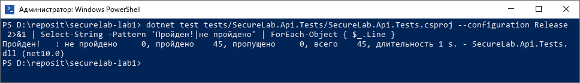

*dotnet test --configuration Release після останньої зміни і reset: 45 з 45 пройдено (build - 0 помилок, 0 попереджень).*

### 3. A-01 - огляд data-access points

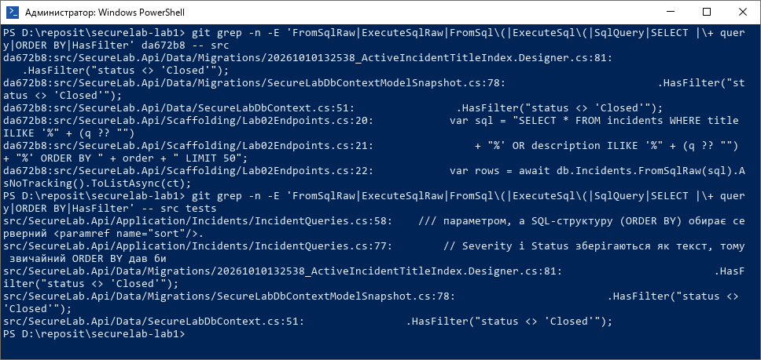

*git grep за FromSqlRaw, ExecuteSqlRaw, FromSql(, ExecuteSql(, SqlQuery, "SELECT ", "+ query", ORDER BY, HasFilter: на da672b8 - небезпечна конкатенація; на fixed - лише коментарі та статичний фільтр індексу.*

| Файл / метод | Що робить | Категорія | Висновок |
|---|---|---|---|
| Scaffolding/Lab02Endpoints.cs - search (da672b8) | конкатенація q і sortBy + FromSqlRaw | потребувала виправлення | виправлено в 20f7d62: LINQ + ILike параметр, allowlist |
| IncidentQueries.SearchAsync | LINQ, EF.Functions.ILike(…, pattern, escape) | параметризований value | безпечно; структуру обирає enum IncidentSearchSort |
| IncidentQueries.GetListAsync / GetDetailsAsync / GetSeveritySummaryAsync | LINQ Where/GroupBy/Select | параметризований value | безпечно; status - типізований enum після перевірки |
| IncidentCommands.CreateAsync | AnyAsync + Add + SaveChanges | параметризований value | безпечно; значення лише після валідатора |
| DbSeeder.Seed/Reset, Lab02Seed, DatabaseBootstrap | MigrateAsync, RemoveRange, AddRange | trusted static | лише фіксовані seed-дані, Development |
| SecureLabDbContext.HasFilter("status <> 'Closed'") і міграції | статичний SQL фільтра індексу | trusted static SQL | немає користувацьких даних |
| Program.cs /health | Database.CanConnectAsync | trusted static | без вводу користувача |

### 4. A-02 - другий подібний дефект і mass assignment

- Дефект: Enum.TryParse + Enum.IsDefined пропускають числові псевдоніми й списки прапорців. У фільтрі списку ЛР 1 GET /api/incidents?status=2 повертав інциденти InProgress, а ?status=New, Triaged - Triaged (докази: a02-before.txt). Те саме стосувалося severity у створенні.
- Виправлення: Application/EnumNames.IsExactName<TEnum> - значення має збігатися з назвою елемента; використано у CreateIncidentValidator і IncidentEndpoints.GetListAsync. Тести: T02_InvalidSeverity_Returns400("2", "Low, High"), A02_ListStatusFilter_NumericOrCombinedAlias_Returns400 (з позитивним контролем ?status=triaged → 200).
- Mass assignment явно заблоковано контрактом: A02_ServerManagedFieldsInBody_AreIgnored читає запис із БД і перевіряє owner = Alice, status = New, серверний CreatedAtUtc і що запису з id від клієнта не існує.

### 5. Контрольна точка CP-03 - перевірений механізм виправлення

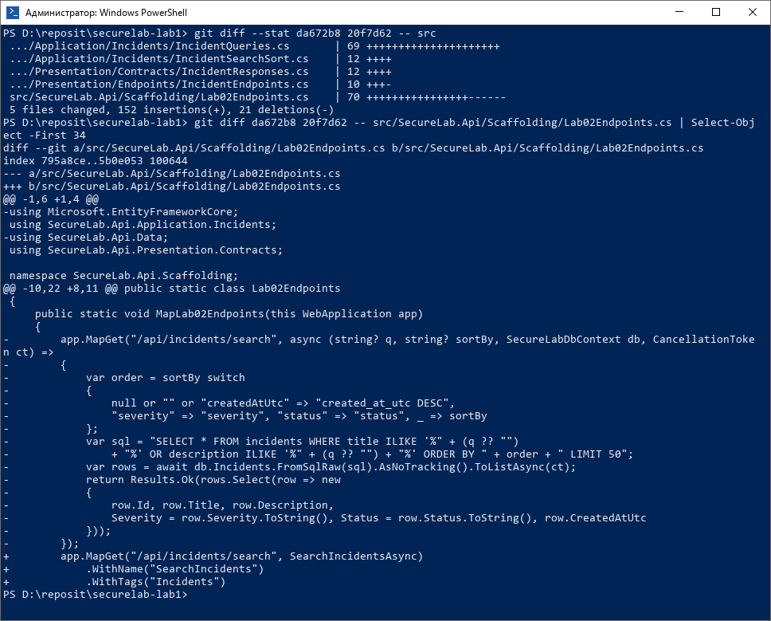

*git diff da672b8 20f7d62: у Lab02Endpoints.cs прибрано складання SQL і FromSqlRaw; пошук делегується IncidentQueries.SearchAsync, sortBy проходить allowlist.*

Конкретна відмінність: раніше СУБД отримувала один текст, у якому q уже був склеєний зі структурою; тепер SQL-шаблон незмінний, значення pattern передається окремим параметром, а ORDER BY обирає серверний allowlist. Невідомий sortBy до SQL не доходить узагалі - endpoint повертає 400 раніше за виклик запиту.

## Security-сценарій

- 1. Контекст і гіпотеза. Локальний GET /api/incidents/search отримує недовірені q і sortBy; ризик - значення увійде до структури SQL.
- 2. Стан до. Vulnerable commit da672b8; Lab02Endpoints.cs, обробник MapGet("/api/incidents/search"), рядки 18 і 20-22 (конкатенація + FromSqlRaw).
- 3. Мінімальний PoC. Власний read-only сценарій SearchSecurityTests.S02_ControlInput_DoesNotWidenResults і останній запит у tests/http/lab-02-incidents.http; без DROP/DELETE/UPDATE, stacked statements, файлових чи мережевих дій.
- 4. Спостереження. Замість 0 записів - 5 (усі штучні інциденти); легітимний апостроф давав 500; q=% повертав усе; sortBy керував ORDER BY.
- 5. Першопричина. q і sortBy з'єднувалися з SQL-текстом до виконання, і PostgreSQL сам відокремлював дані від інструкцій.
- 6. Виправлення. LINQ + EF.Functions.ILike з екрануванням для values; allowlist для structural choice (sortBy); серверна валідація для контракту створення.
- 7. Retest і позитивна регресія. Той самий PoC → 200 і порожня множина; USB, O'Brien і комп'ютерного знаходять очікувані записи без 500; 45/45 тестів.
- 8. Залишковий ризик. Немає authentication/authorization (owner - demo context Alice до ЛР 3), пошук бачить інциденти всіх користувачів; немає пагінації/rate limit (лише Take(50)); ILIKE '%…%' без індексу може бути повільним на великій таблиці; огляд охоплює цей проєкт, а не production logging policy.

## DEL-02. Таблиця фактичних спостережень

| ID | Сценарій | Дія | Очікувано | Фактично | Доказ |
|---|---|---|---|---|---|
| T-01 | Коректне створення | POST /api/incidents, valid DTO | 201, DTO без зайвих полів | 201, Location, 7 полів без ownerUserId/description | sc2-08; T01_ValidRequest_Returns201WithResponseDtoOnly |
| T-02 | Некоректний DTO | severity "7"/"Extreme"/"2", порожній title, без occurredAtUtc, +10 хв, битий JSON, >160/>4000 | 400 problem+json | 400 problem+json, помилки за відповідними ключами, без stack trace/SQL | sc2-07; T02_* (12 кейсів) |
| T-03 | Предметний конфлікт | повторний POST з тим самим title (New/Triaged/InProgress/Resolved) | 409 Problem Details | 409; інший регістр → 201; після Closed → 201 | sc2-08; T03_* |
| S-01 | SQLi до fix | da672b8, контрольний read-only ввід | небажано розширена вибірка | 200, 5 записів замість 0 | sc2-02, sc2-06; search-before.txt |
| S-02 | Retest SQLi | 20f7d62, той самий ввід і seed | порожній результат | 200, 0 записів = еталон q=zz-no-match | sc2-11; S02_ControlInput_DoesNotWidenResults |
| T-04 | Позитивна регресія | q=USB, O'Brien, комп'ютерного | коректні записи, без 500 | 1 запис у кожному випадку; 200 | sc2-12; T04_* |
| T-05 | Невідоме сортування | sortBy=title / "created_at_utc DESC" / Severity | 400 | 400, ключ sortBy | sc2-13; T05_UnknownSortBy_Returns400WithSortByKey |
| T-06 | Ресурс не знайдено | GET /api/incidents/99999999-… | 404 Problem Details | 404 problem+json, без внутрішніх деталей | create-after.txt; GetIncidentDetails_UnknownId_…404 |
| T-09 | Cross-field 2-A | High/Critical, description 39 і 40 після Trim() | 400 (description) / проходить | 39 → 400 description; 40 → 201 | sc2-09; T09_HighOrCritical_* |
| T-10 | Додаткове правило | description дослівно = title (інший регістр) | 400; контроль - успіх | 400 description; розширений опис → 201 | create-after.txt; T10_* |
| A-01 | Огляд data-access | code search з методики | висновок для кожної точки | див. таблицю A-01: одна точка виправлена, решта LINQ/static | sc2-15; a01-code-search.txt |
| A-02 | Другий дефект / mass assignment | ?status=2, severity "Low, High"; body з ownerUserId/status/id | 400; поля ігноруються | 400; owner Alice, status New, новий id | sc2-10; a02-before.txt; A02_* |

Правило T-10 і його межі: description після Trim() не може дорівнювати title після Trim() без урахування регістру (повтор заголовка не пояснює інцидент). Контрольний допустимий стан - опис, що містить title і додаткові відомості. Порушення → 400 з ключем description; перевіряється лише коли обидва поля вже пройшли базову валідацію.

## DEL-01. Git-історія виправлення

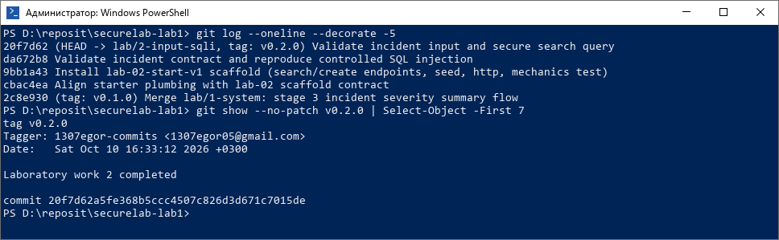

*git log --oneline --decorate і git show --no-patch v0.2.0: annotated tag стоїть на fixed commit, vulnerable commit збережено в історії.*

| Коміт | Зміст |
|---|---|
| cbac4ea | Align starter plumbing with lab-02 scaffold contract |
| 9bb1a43 | Install lab-02-start-v1 scaffold (search/create endpoints, seed, http, mechanics test) |
| da672b8 | Validate incident contract and reproduce controlled SQL injection - vulnerable commit |
| 20f7d62 | Validate incident input and secure search query - fixed commit, tag v0.2.0 |

- Diff між станами: git diff da672b8..20f7d62 (5 файлів у src, +152/−21).
- Передано до remote: git push -u origin lab/2-input-sqli; git push origin v0.2.0.
- Історію не переписано, тег не пересувався; vulnerable commit доступний для перевірки.
- Перед кожним commit переглянуто git diff --staged: немає .env, дампів, логів, cookies чи токенів. Рядок підключення в appsettings.Development.json - успадкований відкритий навчальний пароль лише для 127.0.0.1.

## Відповіді на контрольні питання

- 1. Entity описує збереження й містить server-managed поля (Id, OwnerUserId, Status, audit). Якщо прив'язати її до body, клієнт зможе їх задати - overposting.
- 2. Format validation перевіряє сам запит (обов'язковість, довжина, enum, діапазон дати) → 400; business invariant залежить від поточного стану даних (активний дублікат title) → 409.
- 3. 400 - запит не відповідає контракту; 404 - коректний id, але ресурсу немає; 409 - коректний запит конфліктує зі станом; 500 - неочікуваний збій.
- 4. Stack trace, текст SQL, connection string, паролі, назви внутрішніх класів і компонентів, повідомлення винятків.
- 5. Недовірене значення з'єднується з текстом команди до виконання, і СУБД інтерпретує його частину як структуру.
- 6. Параметр - це завжди значення; ім'я колонки й напрямок сортування - частина структури, параметром їх не передати.
- 7. Клієнт обирає лише логічну назву з фіксованого списку; сервер зіставляє її з власним виразом, а все інше відхиляє 400.
- 8. Ламає легітимні дані (O'Brien, комп'ютерного), не захищає інші контексти (ORDER BY без лапок) і не прибирає змішування даних зі структурою.
- 9. FromSqlRaw виконує рядок як є: якщо його зібрано конкатенацією чи інтерполяцією з даними користувача, ORM нічого не параметризує.
- 10. Що той самий PoC дає правильний статус і очікувану (порожню) множину результатів без зайвих записів, а легітимні запити працюють.

## Чекліст перед поданням

- [x] Baseline 2-A, гілка lab/2-input-sqli, vulnerable da672b8, fixed 20f7d62, тег v0.2.0.
- [x] DTO не приймає OwnerUserId, status та audit-поля.
- [x] Некоректний DTO → безпечний 400 Problem Details; 409 пояснено для предметного конфлікту.
- [x] SQLi відтворено лише локально наданим read-only сценарієм.
- [x] Виправлення усуває з'єднання значення зі SQL-структурою; sortBy має allowlist.
- [x] Retest PoC, apostrophe і normal search виконано й задокументовано.
- [x] Tests запущено після останньої зміни: 45/45.
- [x] У diff, звіті й знімках немає секретів, cookies, токенів, дампів.
- [x] Фінальний тег указує на fixed commit.
